# Malaab — Pickup Games (React + Vite + Tailwind CSS)

**Course:** CSC443 Web Programming · Fall 2026 · Section 31
**Institution:** Lebanese American University · Department of Computer Science and Mathematics
**Topic:** 07 — Pickup Games
**Brief reference code:** `CSC443-F26 · T07 · rev A` (from the footer of `topic-07-pickup-games/index.html`; the eight surface pages use `CSC443-F26 · T07 · S01…S08 · rev A`, and the roster reference is `… · C01 · rev A`)

**Team name:** 2KFC

## Team

| Full name | Student ID | Role |
| --- | --- | --- |
| Christian Nehman | 202403544 | Surfaces 05–06 (create / organising) |
| Kevin Assi | 202302666 | Surfaces 01–02 (home / browse) |
| Keven Abi Frem | 202402903 | Surfaces 07–08 (playing / auth) |
| Francois Seif | 202302904 | Surfaces 03–04 (game detail / venue) |

## What the project is

Malaab is a Phase 1 web app for organising pickup games: a player sees which
games need people, joins one, and can see exactly where they stand. The
organiser manages the roster and the queue. The design specification is the
`topic-07-pickup-games/` folder in this repository; it was read as a
specification, not copied into the app. That folder is explicitly excluded from
deployment by `.vercelignore`, so only our own application is published.

The app is dark on every surface, works down to 390px (including a mobile nav),
makes no network requests, and resets its mock data on reload — all as required
for Phase 1.

## Entities and fields

The data model was settled in `src/data/mockData.ts` and is shared by every
surface. Fields marked *computed* are never stored; they are derived from the
signup list in `src/data/roster.ts`.

### `User`

| Field | Type | Meaning |
| --- | --- | --- |
| `id` | `string` | Stable identifier (`u1`…`u18`, `u<timestamp>` for new accounts) |
| `name` | `string` | Full name shown on rosters |
| `email` | `string` | University address, lowercased; used to sign in |
| `phone` | `string` | Contact number |
| `preferredSports` | `string[]` | Sports the player plays |
| `password` | `string` | Plain text for the Phase 1 mock sign-in only (no server, no hash) |

### `Venue` (reference data — nobody creates, edits or deletes a venue in the app)

| Field | Type | Meaning |
| --- | --- | --- |
| `id` | `string` | `v1`…`v5` |
| `name` | `string` | Venue name |
| `area` | `string` | Neighbourhood |
| `sport` | `'Football' \| 'Basketball' \| 'Padel'` | Main sport |
| `maxPlayers` | `number` | Capacity used by create-game validation |
| `surface` | `string` | e.g. artificial grass |
| `floodlights` | `boolean` | Shown as a "Floodlit" tag |
| `pricePerHour` | `number` | Pitch price per hour |
| `format` | `string` | e.g. `7v7`, `5v5`, `Doubles` |
| `amenities` | `string[]` | Changing rooms, parking, etc. |
| `hours` | `string` | Opening hours |
| `pitches` | `number` | Number of pitches/courts |

### `Game`

| Field | Type | Meaning |
| --- | --- | --- |
| `id` | `string` | `g1`…`g7` or `g<timestamp>` for newly created games |
| `venueId` | `string` | Foreign key to `Venue` |
| `organiserId` | `string` | Foreign key to `User` |
| `sport` | `'Football' \| 'Basketball' \| 'Padel'` | Sport |
| `level` | `'Casual' \| 'Competitive'` | Level |
| `startsAt` | `Date` | Kick-off (seed dates are relative to today) |
| `durationMinutes` | `number` | Length of the game |
| `playersNeeded` | `number` | Spots the organiser asked for |
| `costPerPlayer` | `number` | Cost split |
| `notes` | `string` | Free text (shirt colours, parking, etc.) |
| `status` | `'open' \| 'cancelled' \| 'played'` | Lifecycle state |
| *spots left* | *computed* | `playersNeeded − confirmed signups` (`spotsLeft`) |
| *full* | *computed* | Never stored; derived from spots left |

### `Signup`

| Field | Type | Meaning |
| --- | --- | --- |
| `id` | `string` | Signup identifier |
| `gameId` | `string` | Foreign key to `Game` |
| `playerId` | `string` | Foreign key to `User` |
| `status` | `'confirmed' \| 'waitlisted' \| 'cancelled'` | Roster or queue state |
| `signedUpAt` | `Date` | Arrival time; the queue is sorted by this |
| *queue position* | *computed* | 1-based index in the arrival-ordered waitlist (`queuePosition`); never written into a row |

**House rule (enforced in `src/data/roster.ts` and `src/context/GamesContext.tsx`):**
confirmed signups never exceed `playersNeeded`; once full, players wait in
arrival order and a new join goes to the back of the line; cancelling a
confirmed signup promotes the first player waiting, and everybody else shifts
up automatically because positions are computed, not stored.

## Member → surface → file mapping

| Member | Surface | Route | Source file(s) |
| --- | --- | --- | --- |
| Kevin Assi | 01 Home — pitch, tonight's games, three rules | `/` | `src/pages/Home.tsx` |
| Kevin Assi | 02 Browse — list, filters, four data states | `/games` | `src/pages/Browse.tsx`, `src/components/FilterBar.tsx` |
| Francois Seif | 03 Game detail — viewer variants, roster, queue | `/games/:id` | `src/pages/GameDetail.tsx`, `src/components/Roster.tsx` |
| Francois Seif | 04 Venue — reference data and games at the venue | `/venues/:id` | `src/pages/Venue.tsx` |
| Christian Nehman | 05 Start a game — validation, unsaved-changes guard | `/create` | `src/pages/CreateGame.tsx`, `src/components/Field.tsx` |
| Christian Nehman | 06 Organising — your games and the queue you manage | `/my-games/organising` | `src/pages/Organising.tsx` |
| Keven Abi Frem | 07 Playing — where you stand in other people's games | `/my-games/playing` | `src/pages/Playing.tsx` |
| Keven Abi Frem | 08 Sign in / sign up — both states and a rejected sign-in | `/signin`, `/signup` | `src/pages/Auth.tsx`, `src/context/AuthContext.tsx` |

Shared infrastructure used by all surfaces: `src/App.tsx` (routing),
`src/components/Layout.tsx` (header, mobile nav, footer),
`src/components/GameCard.tsx` (one data-driven card for Home, Browse and Venue),
`src/components/ui.ts` (buttons/badges/input classes), `src/components/ConfirmDialog.tsx`,
`src/context/GamesContext.tsx`, `src/data/mockData.ts`, `src/data/roster.ts`,
`src/utils/format.ts`.

`feat/francois-part` was merged into `main` and is the source of the game
detail, venue and roster components; `feat/03-game` and `feature/playing-auth`
are kept in sync with `main`.

## How the mock data is structured and where it lives

- **`src/data/mockData.ts`** is the single source of seed data: `seedUsers`
  (18 members), `venues` (5), `seedGames` (7), `seedSignups`, plus `DEMO_EMAIL`
  (`demo.player@lau.edu`) and `DEMO_PASSWORD` (`malaab2026`). Game and signup
  dates are computed relative to "today" so "Tonight"/"Tomorrow" stay true.
  Signups are listed in arrival order; the first `playersNeeded` are confirmed
  and the rest are waitlisted, so the house rule holds on the very first render.
- **`src/context/AuthContext.tsx`** holds `users` and `currentUser` in React
  state and exposes `signIn`, `signUp`, `signOut`, `emailTaken`. It also supplies
  the avatar initials used by the roster.
- **`src/context/GamesContext.tsx`** holds `games` and `signups` in React state
  and exposes `createGame`, `updateGame`, `joinGame`, `cancelSignup` and
  `cancelGame`. Because the state is shared, a cancellation on one page is
  immediately visible on every other page.
- **`src/data/roster.ts`** contains the house rule as pure functions
  (`confirmedFor`, `queueFor`, `spotsLeft`, `signupFor`, `queuePosition`,
  `cancelSignup`). Spots and queue positions are computed from the signups,
  never stored.
- No `localStorage`, no API calls and no backend in Phase 1: **a full page
  reload resets everything to the seed data.** This is why the browser testing
  signs in and then navigates inside the app rather than reloading.

### Reaching the built-in states

- `/games?state=loading`, `?state=empty`, `?state=error` — Browse data states.
- `/my-games/playing?state=loading|empty|error` — Playing data states.
- `/games/:id?state=loading|error|empty` — Game detail states.
- Sign out for the signed-out variant; sign in as the organiser of `g5`
  (Christian Nehman) for the owner variant, or as any other user for the
  member variant. `g1` and `g2` start with queues so promotion can be tried.

## How to run locally (from clone to running dev server)

You need **Node.js 22 LTS** (Node 20.19+ also works) and npm 10+, plus Git.
No API keys, database or backend are required.

```powershell
# 1. Clone the repository
git clone https://github.com/Kevboslayz/Malaab-Web-Dev-Project-2KFC.git

# 2. Enter the project folder
cd Malaab-Web-Dev-Project-2KFC

# 3. Install the dependencies
npm install

# 4. Start the Vite dev server
npm run dev
```

Open **<http://localhost:5173/>** in a browser. Press `Ctrl+C` in the terminal to
stop the server.

Optional commands:

```powershell
npm run build      # TypeScript check + production build into dist/
npx vite preview   # serve the production build locally
```

All branches (`main`, `feat/francois-part`, `feat/03-game`,
`feature/playing-auth`) point at the same working commit, so checking out any
of them gives you the same application.

**Demo sign-in:** `demo.player@lau.edu` / `malaab2026` (a dummy account).
Every seeded user uses the password `malaab2026`.

## Deploying to Vercel (Hobby / free)

The app is a static Vite SPA: there is no backend, database or paid service in
Phase 1, so the **Vercel Hobby (free) plan is sufficient**.

Everything needed for deployment is already committed:

| File | Purpose |
| --- | --- |
| `vercel.json` | Framework preset `vite`, `npm run build`, output `dist`, and a SPA rewrite to `/index.html` so deep links such as `/games/g5` and `/my-games/playing` work after a refresh. The rewrite deliberately excludes `/api/` (reserved for Phase 2) and static asset paths. |
| `.vercelignore` | Keeps `topic-07-pickup-games/` (the supplied specification), `docs/`, Markdown files and local scripts out of the upload — **only our work is deployed**. `node_modules` and `dist` are excluded too; Vercel installs and builds fresh. |
| `package.json` | `build` script is `tsc && vite build`; `engines.node` pins a Vite-8-compatible Node runtime. |
| `.env.example` | Documents environment variables. **Phase 1 needs none.** |

### Deploy from the Vercel dashboard (recommended)

1. Make sure `main` on GitHub contains this README and the files above
   (all four branches are kept in sync).
2. Sign in at <https://vercel.com/> with GitHub and choose **Add New → Project**.
3. Import the repository:
   `https://github.com/Kevboslayz/Malaab-Web-Dev-Project-2KFC.git`.
4. Accept the detected settings (they are also in `vercel.json`):
   - **Framework Preset:** Vite
   - **Root Directory:** `./` (leave as default)
   - **Install Command:** `npm install`
   - **Build Command:** `npm run build`
   - **Output Directory:** `dist`
5. **Environment Variables:** none for Phase 1 — leave empty and deploy.
6. Click **Deploy**. Vercel also creates automatic preview deployments for
   every branch and pull request.

Optional CLI route (requires a Vercel account/login):

```powershell
npm install -g vercel
vercel login
cd Malaab-Web-Dev-Project-2KFC
vercel --prod
```

### Check the deployment after it finishes

- Open the root URL: the Home page should render with the dark theme.
- Open and then **refresh** a deep link such as `/games/g5` and `/venues/v1` —
  they must still load. That confirms the `vercel.json` SPA rewrite works.
- `/favicon.svg` should return an SVG (it comes from `public/`).
- Confirm the build log used `npm run build` and produced `dist/`.

### Ready for Phase 2

- **API routes:** add serverless functions under `api/` (for example
  `api/games.ts`). The SPA rewrite excludes `/api/`, so they will be reachable
  without changing `vercel.json`.
- **Secrets:** put database URLs and API keys in Vercel **Project Settings →
  Environment Variables** and read them only inside `/api` functions. Never put
  a secret in a `VITE_` variable — Vite embeds those in client-side code.
- **Client config:** if the frontend needs an API address, add `VITE_API_BASE_URL`
  in the Vercel dashboard (see `.env.example`) and use `import.meta.env` in the
  app. The contexts in `src/context/` are the single place to swap mock state
  for real requests; no routing or deploy config needs to change.
- **Cost:** adding functions and a Vercel-backed database can exceed Hobby
  limits; keep Phase 2 on the free tier to stay inside the same plan.

> This repository is prepared for Vercel but not deployed from this machine —
> no Vercel account or token was available here. Follow the steps above, then
> paste the resulting URL into the project's live-link record.

## Security review (pre-deploy)

- **Dependencies:** `npm audit` and `npm audit --omit=dev` both report **0
  vulnerabilities**. Keep dependencies updated in Phase 2.
- **Secrets:** no API keys, tokens, private keys or credential files exist in
  the working tree or anywhere in git history (scanned all commits). Only
  `.env.example` exists and it contains comments only. `.gitignore` and
  `.vercelignore` both exclude `.env` / `.env.*` so local environment files
  cannot be committed or uploaded. Vercel secrets belong in the dashboard.
- **Client code:** React escapes all rendered values; there is no
  `dangerouslySetInnerHTML`, `eval`, `new Function`, user-controlled inline
  style, or external script/font request. No network calls, no `localStorage`
  or `sessionStorage` in Phase 1.
- **Open redirect:** `safeNext()` in `src/pages/Auth.tsx` accepts only a plain
  local path. Protocol-relative URLs (`//host`), backslash tricks (`/\host`)
  and control characters are rejected, so `?next=` cannot send a user off-site
  after sign-in.
- **Browser-verified:** an `` payload typed into game notes is
  rendered as inert text and never executes; both `?next=//host` and
  `?next=/\host` land on `/` after sign-in; no external network requests were
  observed on any surface.
- **Response headers:** `vercel.json` sets `nosniff`, `X-Frame-Options: DENY`,
  `Referrer-Policy`, `Permissions-Policy` and a Content-Security-Policy that
  allows self-hosted scripts/styles/fonts (with `data:` only for the embedded
  fonts). The CSP can suppress Vercel's *preview toolbar* in preview
  deployments; the production app is unaffected.
- **CSRF:** there are no cookies and no authenticated server requests in
  Phase 1, so there is no CSRF surface. Revisit this when Phase 2 adds a
  session (SameSite cookies / CSRF tokens).

**Accepted Phase 1 risks, by design:** `DEMO_PASSWORD` and the seeded user
passwords are plain text in the client bundle, so anyone can sign in as a
seeded user — that is the mock authentication the brief asks for. Seed email
addresses and phone numbers are invented mock data. **Phase 2 must move
authentication and the house rule to the server**, store salted password
hashes, validate at the API boundary, add rate limiting, and delete these
client-side constants.

## Screenshots and recording

All screenshots below were captured from the running app in headless Chrome;
the two mobile shots are at **390px**. Click an image to open it full-size.

| Surface | Screenshot |
| --- | --- |
| 01 Home | [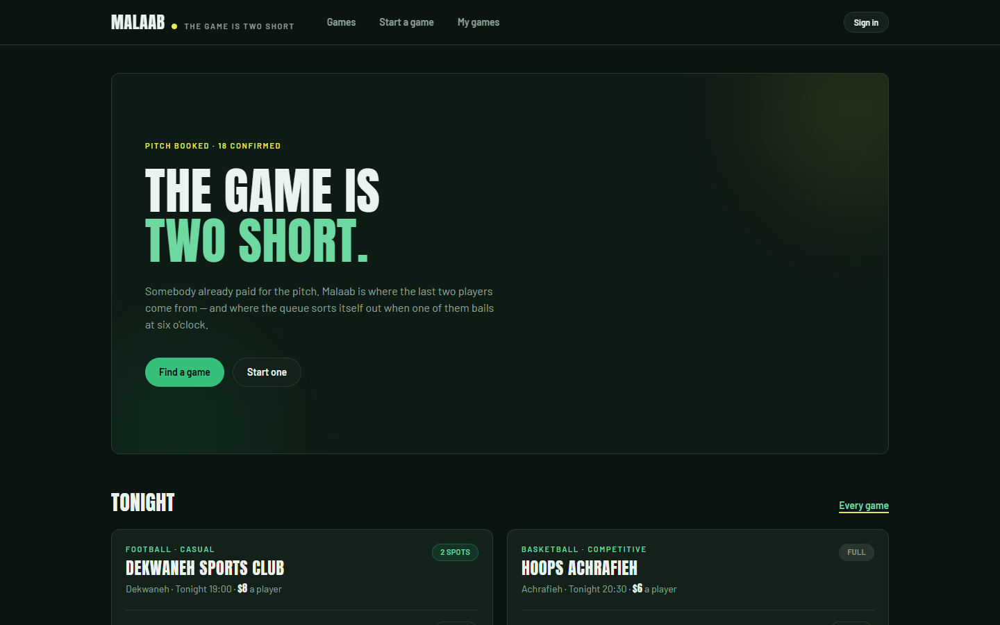](docs/screenshots/01-home.png) |
| 02 Browse | [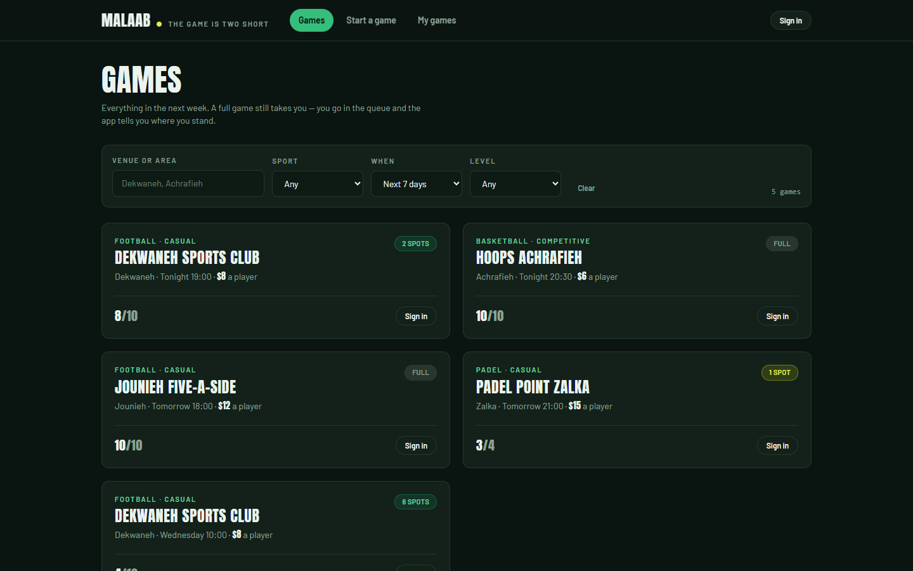](docs/screenshots/02-browse.png) |
| 03 Game detail — signed out | [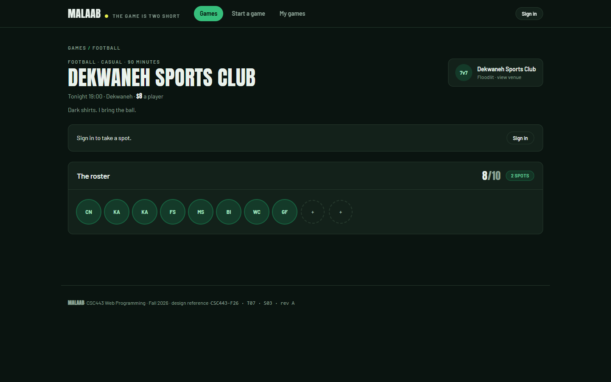](docs/screenshots/03-game-signed-out.png) |
| 03 Game detail — organiser, roster + queue | [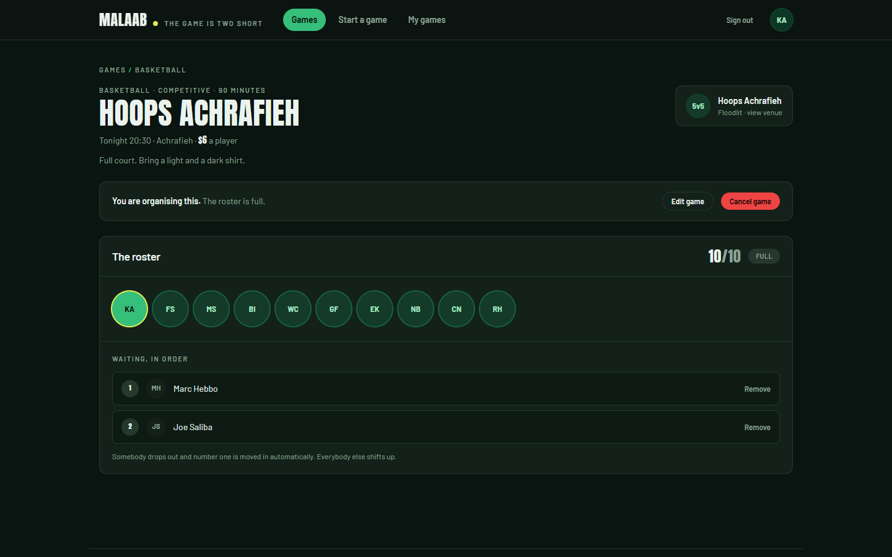](docs/screenshots/03-game-organiser.png) |
| 04 Venue | [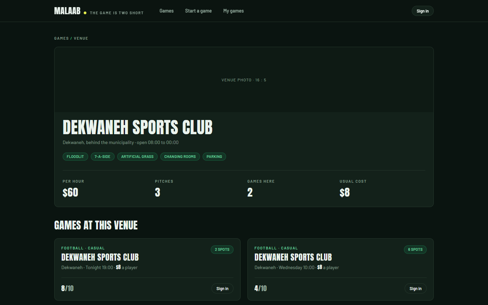](docs/screenshots/04-venue.png) |
| 05 Start a game | [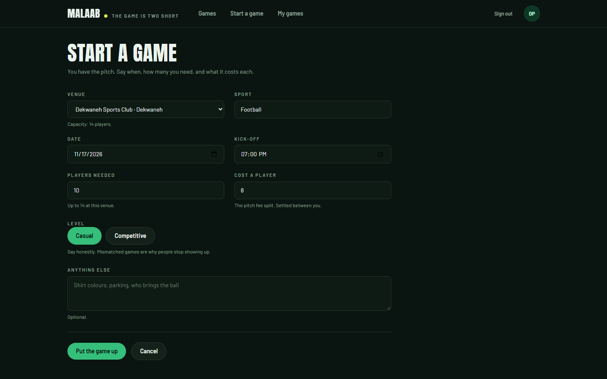](docs/screenshots/05-create.png) |
| 06 Organising | [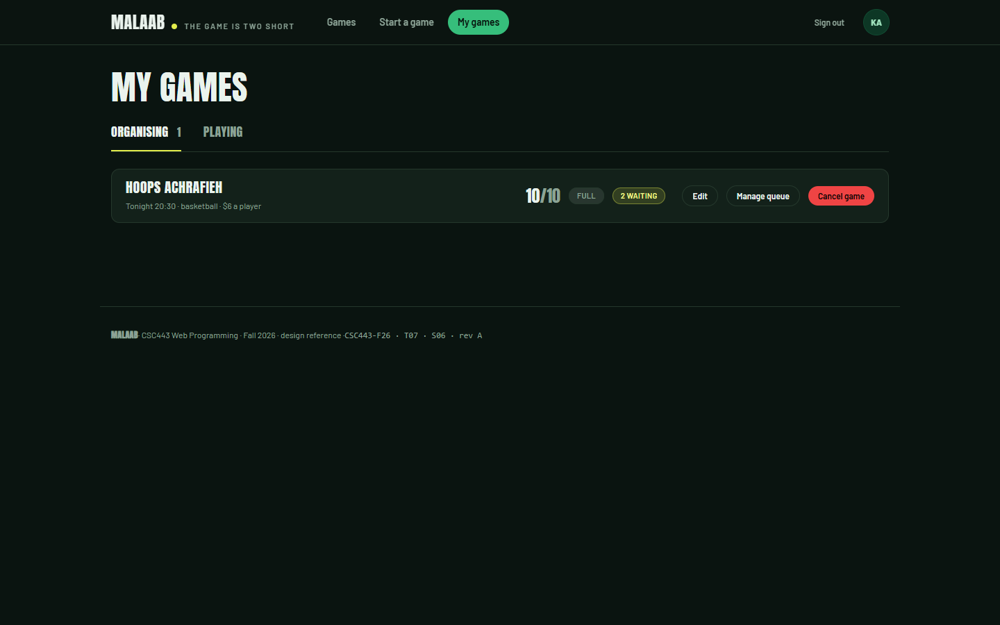](docs/screenshots/06-organising.png) |
| 07 Playing | [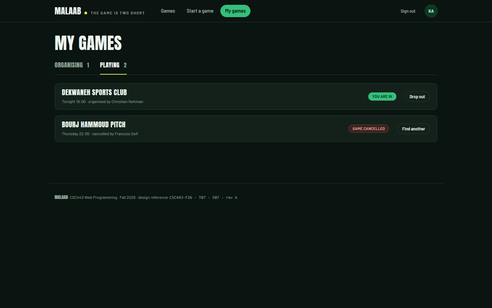](docs/screenshots/07-playing.png) |
| 08 Sign in | [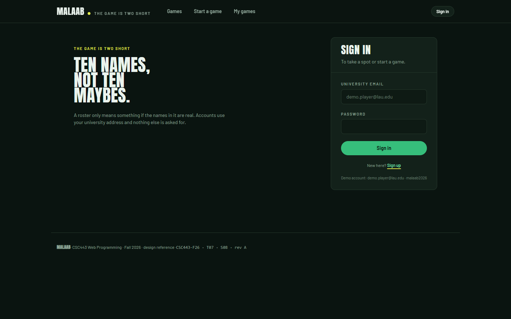](docs/screenshots/08-signin.png) |
| 390px — Home | [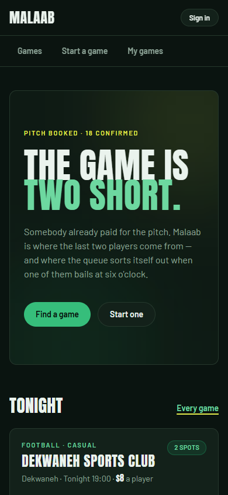](docs/screenshots/mobile-home.png) |
| 390px — Game detail | [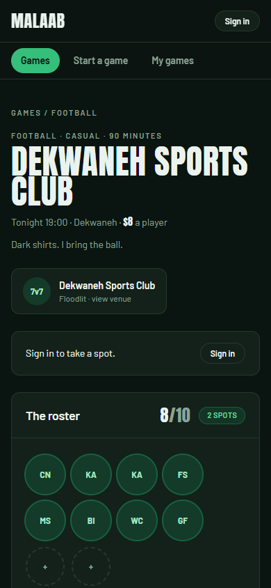](docs/screenshots/mobile-game.png) |

A short recording can be added here once the team exports one; the screenshots
above cover every surface and the responsive layout.

## Verification performed

- `npm run build` — TypeScript type-check and production build both pass.
- Automated headless-browser run: 23 checks across all eight surfaces,
  including the four data states, the three viewer variants, join/leave/drop
  out, automatic queue promotion, validation, the unsaved-changes guard,
  `?next=` redirects, 390px layout and zero console/page errors.
